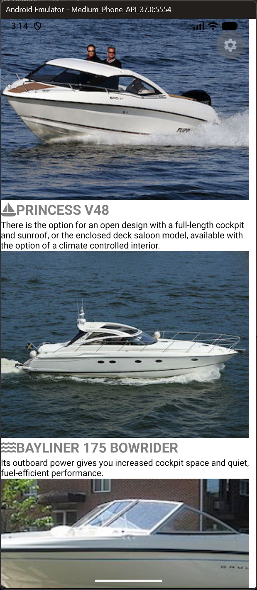
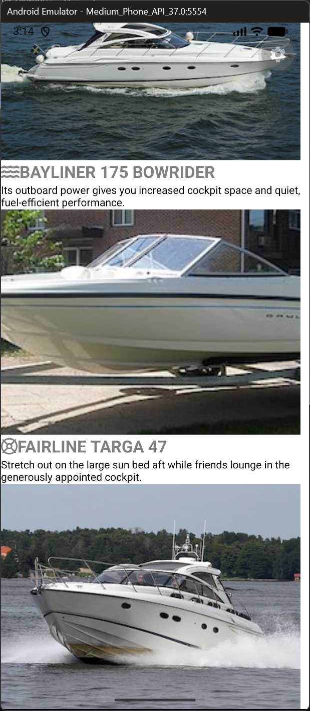

# App Name

GetABoat is a mobile application built using React Native and Expo. 
The app displays six different boats available for sale. 
Each boat includes its name, an icon, a short description, and a picture. 
Users can scroll down to view all the boats and learn about their features.

# ScreenShots of App
Top page screenshot:  

Bottom page screenshot:  
